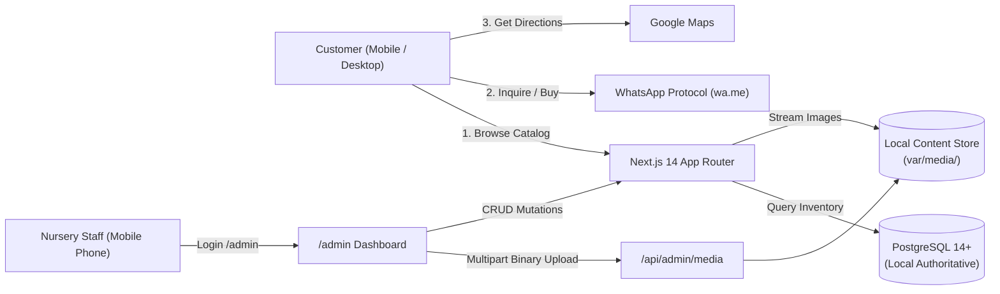

# Nature House — Digital Showcase & Mobile Admin Portal

> **A biophilic, high-performance digital catalog & mobile admin portal for botanical nurseries and handcrafted aquarium studios.**  
> Calibrated for lean, high-speed delivery, rock-solid persistence, and strict security compliance.

---

## 🌿 Project Overview

Nature House bridges two living art forms:
1. **Lush Plant Nursery:** Curated indoor foliage, exotic specimens, outdoor greens, and balcony terrarium flora.
2. **Handcrafted Aquariums:** Custom-built opti-white rimless glass tanks, complete aquascapes, and hardscapes.

Rather than forcing users through complex carts and account registrations, Nature House uses a **zero-friction "Browse & WhatsApp" conversion loop** with one-tap inquiries and Google Maps store navigation.

---

## 📚 Complete Project Documentation Suite

The project is thoroughly documented across dedicated specifications in `design_docket/`:

| Document | Primary Focus | Key Highlights |
| :--- | :--- | :--- |
| **[CODEBASE_AUDIT.md](file:///mnt/d/Nature_House/design_docket/CODEBASE_AUDIT.md)** | Architectural & Security Audit | Root cause analysis across 14 audit findings and comprehensive 6-phase remediation plan. |
| **[Architecture.md](file:///mnt/d/Nature_House/design_docket/Architecture.md)** | System Architecture & Structural Design | Single-node Node.js App Router, local PostgreSQL DAL, local `MediaStore`, and security layers. |
| **[DATABASE.md](file:///mnt/d/Nature_House/design_docket/DATABASE.md)** | Database Architecture & Migrations | PostgreSQL DDL migrations (`database/migrations/`), `schema_migrations`, typed errors, and media queue. |
| **[API.md](file:///mnt/d/Nature_House/design_docket/API.md)** | API & Data Interface Specification | Route Handlers, schema validation, `/api/admin/media`, and streaming `/media/[mediaId]`. |
| **[SECURITY_PRIVACY.md](file:///mnt/d/Nature_House/design_docket/SECURITY_PRIVACY.md)** | Security, Privacy & DPDP Compliance | Zero-PII public posture, scrypt salted hashing, session versioning, and decommissioned public reset. |
| **[RUNBOOK.md](file:///mnt/d/Nature_House/design_docket/RUNBOOK.md)** | Operations & Local Runbook | Setup commands, migration runner (`db-migrate.mjs`), CLI admin tools (`admin-create`, `admin-reset`). |
| **[TESTING_QA.md](file:///mnt/d/Nature_House/design_docket/TESTING_QA.md)** | QA & Performance Verification | Cross-device test matrix, mobile compression, and 97-point automated test suite (100% pass rate). |
| **[PROJECT_COMPLETION_LOG.md](file:///mnt/d/Nature_House/design_docket/PROJECT_COMPLETION_LOG.md)** | Project Progress & Completion Log | Full changelog of Phases 1–6 and complete audit remediation ledger. |

---

## ⚡ Core Architecture & Technology Stack

- **Frontend & App Engine:** Next.js 14 (App Router, Server Components, Route Handlers)
- **Styling & Motion:** Tailwind CSS + Framer Motion (60fps biophilic design system)
- **Database Layer:** Local PostgreSQL with connection pooling (`pg`), typed errors, and transaction support
- **Local Storage Pipeline:** Content-addressable `var/media/` storage with MIME magic-byte validation and safe streaming
- **Administrative CLI Suite:** Offline credential creation (`scripts/admin-create.mjs`) and password recovery (`scripts/admin-reset.mjs`)
- **Automated Verification:** 97-point end-to-end system and connectivity suite (100% pass rate)
