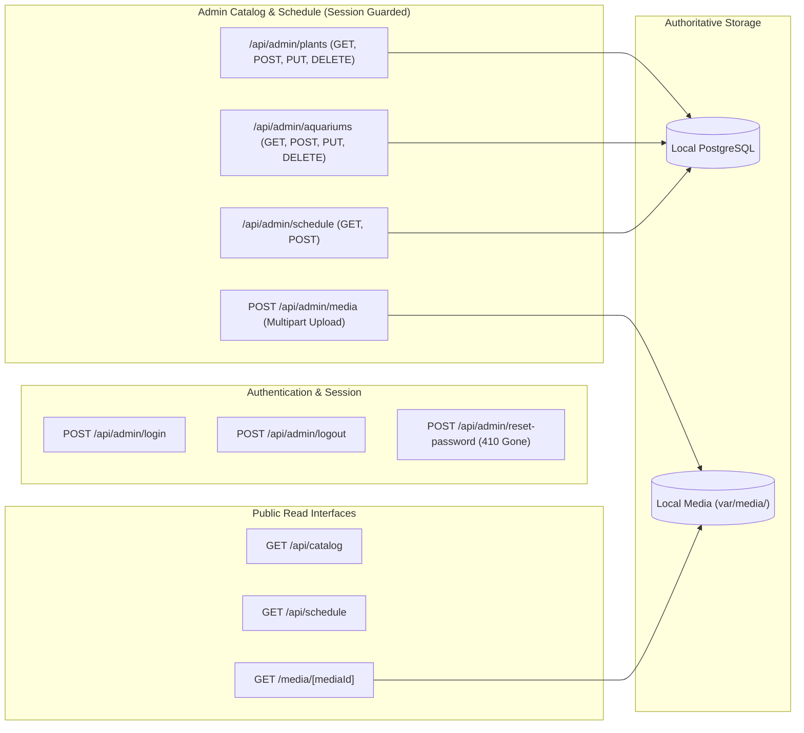

# API & Data Interface Specification

**Project Name:** Nature House (Digital Catalog & Admin Portal)  
**Architecture:** Next.js 14 App Router (Route Handlers + Server-Side Validation)  
**Authentication:** Signed HMAC-SHA256 Session Cookie (`nature_house_admin_session`)  
**Error Handling:** Typed Errors (`ValidationError`, `UnauthorizedError`, `PersistenceError`) via `handleApiError`  

---

## 1. Architectural Overview



---

## 2. Public Endpoints

### 2.1 `GET /api/catalog`
Returns live catalog datasets (`plants` and `aquariums`) with `Cache-Control: no-store, max-age=0`.
- **Response `200 OK`:**
```json
{
  "plants": [...],
  "aquariums": [...]
}
```

### 2.2 `GET /api/schedule`
Returns active schedule notices, broadcast announcements, and store operating hours.
- **Query Parameters (Optional):**
  - `year`: 4-digit year (bounded 2026–2031)
  - `month`: 1-indexed month (1–12)
- **Response `200 OK`:**
```json
{
  "notices": [...],
  "studioNotice": "...",
  "storeInfo": { ... }
}
```

### 2.3 `GET /media/[mediaId]`
Safe streaming endpoint for local media assets.
- **Security Protections:** Validates UUID regex to prevent path traversal; inspects content for valid MIME type.
- **Headers:**
  - `Content-Type: image/jpeg` (or `image/png`, `image/webp`)
  - `X-Content-Type-Options: nosniff`
  - `Cache-Control: public, max-age=31536000, immutable`

---

## 3. Administrative Authentication Endpoints

### 3.1 `POST /api/admin/login`
Authenticates administrative staff with rate-limiting defense.
- **Request Body (JSON):**
```json
{
  "email": "admin@naturehouse.in",
  "password": "owner_password"
}
```
- **Response `200 OK`:**
  Sets `nature_house_admin_session` cookie (`HttpOnly`, `SameSite=Lax`, `maxAge=604800`).
```json
{
  "success": true,
  "admin": {
    "email": "admin@naturehouse.in",
    "name": "Administrator",
    "role": "owner"
  }
}
```
- **Response `401 Unauthorized` / `429 Too Many Requests`:**
  Returns generic error message to prevent user enumeration.

### 3.2 `POST /api/admin/logout`
Terminates active administrative session.
- **Method:** Strictly `POST` (rejects `GET`).
- **Response `200 OK`:** Clears `nature_house_admin_session` cookie.

### 3.3 `POST /api/admin/reset-password`
- **Status:** **410 Gone (Permanently Decommissioned)**
- **Response:**
```json
{
  "error": "Disabled for security: use local CLI (node scripts/admin-reset.mjs)"
}
```

---

## 4. Administrative Catalog & Media Endpoints

### 4.1 `/api/admin/plants`
Session-guarded CRUD endpoint for botanical inventory.
- **`GET`**: Lists all plants from PostgreSQL.
- **`POST`**: Validates input schema via `validatePlantInput()`, creates record in PostgreSQL, and revalidates cache.
- **`PUT`**: Updates plant attributes or stock status.
- **`DELETE`**: Deletes plant record and enqueues associated `imageUrl` in `media_cleanup_queue`.

### 4.2 `/api/admin/aquariums`
Session-guarded CRUD endpoint for artisanal aquariums (full feature parity with plants).
- **`GET`**: Lists all aquariums from PostgreSQL.
- **`POST`**: Validates input schema via `validateAquariumInput()`, creates record, and revalidates cache.
- **`PUT`**: Updates aquarium attributes or stock status.
- **`DELETE`**: Deletes aquarium record and enqueues associated `imageUrl` in `media_cleanup_queue`.

### 4.3 `POST /api/admin/media`
Authenticated multipart file upload endpoint.
- **Headers:** `Content-Type: multipart/form-data`
- **Body:** `file` (binary image blob)
- **Validation:** Enforces MIME magic bytes (JPEG, PNG, WebP) and 10 MB maximum file size.
- **Response `201 Created`:**
```json
{
  "success": true,
  "media": {
    "id": "c1f7a0b3-9d4e-4b2a-8f1e-5a6b7c8d9e0f",
    "url": "/media/c1f7a0b3-9d4e-4b2a-8f1e-5a6b7c8d9e0f.webp",
    "mimeType": "image/webp",
    "fileSize": 145892
  }
}
```

### 4.4 `/api/admin/schedule`
Session-guarded endpoint for store notices and calendar management.
- **`GET`**: Fetches notices and calendar data.
- **`POST`**: Creates or updates store schedule notices with boundary validation (`startDate`, `endDate`).
