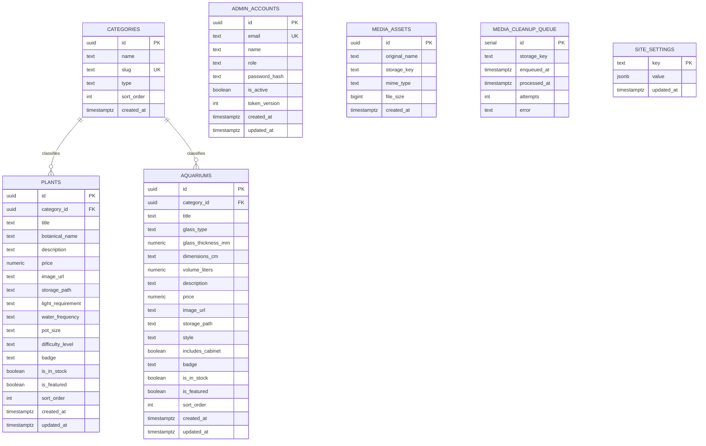

# Database Architecture & Storage Specification

**Project Name:** Nature House (Digital Catalog & Admin Portal)  
**Document Version:** v1.0 (Finalized for Production Deployment)  
**Date:** October 19, 2026  
**Status:** Approved & Finalized for Deployment  
**Database Engine:** PostgreSQL (Node.js `pg` Connection Pool)  
**Media Storage Engine:** Content-Addressable Filesystem Store (`var/media/`)  
**Migration Engine:** Migration Runner (`scripts/db-migrate.mjs` tracking `schema_migrations`)  

---

## 1. Architectural Philosophy & Local Storage Model

The database and storage architecture follows three foundational rules:
1. **Local PostgreSQL as Authoritative Store:** All inventory entities (`plants`, `aquariums`), administrative identities (`admin_accounts`), and media asset manifests (`media_assets`, `media_cleanup_queue`) are authoritatively stored in local PostgreSQL. When PostgreSQL is offline during development, read services gracefully fall back to local disk snapshot fixtures (`runtimeCatalog.json`, `runtimeSchedule.json`), while mutations fail closed with typed errors.
2. **Deterministic Migration Versioning:** Database structure is managed via numbered, idempotent migration files in `database/migrations/` executed through `node scripts/db-migrate.mjs`. Executed scripts are tracked in `schema_migrations`.
3. **Local Atomic Media Pipeline & Cleanup Queue:** Media uploads are validated using MIME magic-byte inspection (JPEG, PNG, WebP), stored atomically to `var/media/` with unique UUID keys, and streamed safely via `/media/[mediaId]`. When catalog records are deleted, media assets are enqueued in `media_cleanup_queue` for deletion.

---

## 2. Entity Relationship Diagram (ERD)



---

## 3. Database Migrations

### 3.1 Migration Tracking
Migrations are located in `database/migrations/`:
- `001_initial_schema.sql`: Core catalog DDL (`categories`, `plants`, `aquariums`, `site_settings`), triggers, and indexing.
- `002_admin_and_media.sql`: Security and media subsystem (`admin_accounts`, `media_assets`, `media_cleanup_queue`).

The runner `scripts/db-migrate.mjs` creates and manages the `schema_migrations` table:
```sql
CREATE TABLE IF NOT EXISTS schema_migrations (
    name VARCHAR(255) PRIMARY KEY,
    applied_at TIMESTAMPTZ NOT NULL DEFAULT timezone('utc'::text, now())
);
```

### 3.2 Running Migrations
To execute all pending migrations against the configured database:
```bash
node scripts/db-migrate.mjs
```

---

## 4. Administrative Accounts & Media Tables

### 4.1 Admin Accounts Table
```sql
CREATE TABLE IF NOT EXISTS public.admin_accounts (
    id UUID PRIMARY KEY DEFAULT gen_random_bytes(16)::uuid,
    email TEXT NOT NULL UNIQUE,
    name TEXT NOT NULL DEFAULT 'Administrator',
    role TEXT NOT NULL DEFAULT 'manager',
    password_hash TEXT NOT NULL,
    is_active BOOLEAN NOT NULL DEFAULT true,
    token_version INT NOT NULL DEFAULT 1,
    created_at TIMESTAMPTZ NOT NULL DEFAULT timezone('utc'::text, now()),
    updated_at TIMESTAMPTZ NOT NULL DEFAULT timezone('utc'::text, now())
);
```
- `token_version`: Incremented upon every password reset or credential update to invalidate all existing issued sessions.
- `password_hash`: Salted `scrypt` string (`scrypt$<salt>$<derivedKey>`).

### 4.2 Media Manifest & Cleanup Queue
```sql
CREATE TABLE IF NOT EXISTS public.media_assets (
    id UUID PRIMARY KEY DEFAULT gen_random_bytes(16)::uuid,
    original_name TEXT NOT NULL,
    storage_key TEXT NOT NULL UNIQUE,
    mime_type TEXT NOT NULL,
    file_size BIGINT NOT NULL,
    created_at TIMESTAMPTZ NOT NULL DEFAULT timezone('utc'::text, now())
);

CREATE TABLE IF NOT EXISTS public.media_cleanup_queue (
    id SERIAL PRIMARY KEY,
    storage_key TEXT NOT NULL,
    enqueued_at TIMESTAMPTZ NOT NULL DEFAULT timezone('utc'::text, now()),
    processed_at TIMESTAMPTZ,
    attempts INT NOT NULL DEFAULT 0,
    error TEXT
);
```

---

## 5. Local Media Pipeline (`var/media/`)

1. **Storage Location:** Files are written to `<project_root>/var/media/<uuid>.<ext>`.
2. **Atomic Writes:** Uploads write to `<project_root>/var/media/tmp/<uuid>.tmp` before an atomic `fs.rename` to the permanent location.
3. **MIME Magic Byte Validation:** File contents are inspected for byte signatures:
   - JPEG: `FF D8 FF`
   - PNG: `89 50 4E 47 0D 0A 1A 0A`
   - WebP: `52 49 46 46 ... 57 45 42 50`
4. **Safe Streaming Route:** `GET /media/[mediaId]` streams files with:
   - `Content-Type`: validated MIME type
   - `X-Content-Type-Options: nosniff`
   - `Cache-Control: public, max-age=31536000, immutable`
   - Strict UUID regex path traversal defense.
