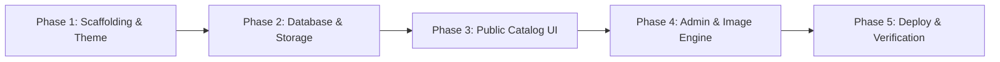

# Comprehensive Project Plan: Nature House Digital Showcase & Admin Portal

**Project Name:** Nature House (Plant Nursery & Handcrafted Aquariums)  
**Document Version:** 7.0 (Production Blueprint — Option 1 Stack Confirmed)  
**Selected Technology Stack:** Next.js 14 (App Router) + Supabase (PostgreSQL, Auth, Storage) + Tailwind CSS + Framer Motion + Vercel  
**Hosting & Operating Cost:** **$0 / ₹0 monthly lifetime free tier**  
**Core Directive:** When hosted, the public experience is strictly a **pure, soothing, interactive digital catalog** (Plants & Aquariums) with instant WhatsApp inquiries and physical nursery location. All catalog management (phone photo uploads, card editing, stock toggles, and cascade deletions) is handled through a private, mobile-optimized admin dashboard (`/admin`).

---

## 1. Executive Summary & Strategic Approach

### 1.1 Business Context & Value Proposition
Nature House bridges two living art forms:
1. **Plant Nursery:** Lush indoor foliage, exotic specimens, outdoor flowering plants, aquatic terrarium flora, pots, and organic soil.
2. **Handcrafted Aquariums:** Custom-built glass tanks (opti-white ultra-clear glass, rimless, machine-beveled), complete planted aquascapes, and hardscapes.

### 1.2 Why Option 1 (Next.js 14 + Supabase + Vercel)?
- **100% Free Forever:** Zero monthly server, database, or storage costs. Stays under 8% of all free tier quotas.
- **Biophilic & Interactive Visuals:** Silky smooth 60fps spring transitions, translucent frosted glassmorphism, and edge-to-edge photo zoom inspection that reflect lush greenery and crystal-clear water.
- **Mobile-First Phone Admin:** The owner can stand inside the nursery, take a photo with their smartphone camera, enter the price and care specs, and publish to the live site in under 15 seconds.
- **Zero Maintenance:** Serverless infrastructure with no WordPress plugins to update, no PHP servers to patch, and no security vulnerabilities.

---

## 2. Information Architecture & User Journeys

```
┌────────────────────────────────────────────────────────────────────────┐
│                        NATURE HOUSE ARCHITECTURE                       │
├──────────────────────────────────┬─────────────────────────────────────┤
│      PUBLIC CATALOG EXPERIENCE   │        PRIVATE OWNER PORTAL         │
│            Route: (/)            │           Route: (/admin)           │
├──────────────────────────────────┼─────────────────────────────────────┤
│ • Biophilic Header & Store Status│ • Secure Authentication (PIN / Pass)│
│ • Section Switcher (Plants / Aqua│ • Mobile Camera Photo Uploader      │
│ • Category Filter Pills          │ • Client-Side WebP Auto-Compression │
│ • Interactive Model Cards        │ • Create / Edit / Toggle Stock      │
│ • Photo Zoom Lightbox Inspection │ • Delete Cards + Auto Photo Purge   │
│ • Pre-filled WhatsApp Inquiry    │ • Real-time Catalog Sync (<1 sec)   │
│ • Location, Hours & Google Maps  │ • Hidden from Public Navigation     │
└──────────────────────────────────┴─────────────────────────────────────┘
```

### 2.1 Customer Journey (Public Catalog)
1. **Discovery:** Customer visits the website (via Instagram bio, Google Maps listing, or direct link).
2. **First Impression:** Fast initial load (<1 second) on a soothing, warm linen canvas with subtle emerald & aqua ambient glows. Store status badge shows `🟢 Open Now • Closes at 8:30 PM`.
3. **Exploration:** 
   - Customer toggles between **🌿 Fresh Nursery Plants** and **🐟 Handcrafted Aquariums** using a smooth sliding pill.
   - Filters by category (e.g., *Indoor Greens*, *Rimless Glass Tanks*).
   - Taps any photo to open a full-screen zoom lightbox to inspect leaf health or aquarium glass joints.
4. **Direct Inquiry / Conversion:**
   - Customer taps **"💬 Inquire on WhatsApp"** on any card.
   - WhatsApp immediately opens with a pre-filled, formatted message including the item name, dimensions, and price.
5. **Physical Store Visit:**
   - Customer scrolls to the location section, reviews parking and timings, and taps **"Get Directions"** to open turn-by-turn navigation in Google Maps.

### 2.2 Owner Journey (Private Admin Portal)
1. **Access:** Owner opens `naturehouse.com/admin` on their smartphone and enters their secure PIN or password.
2. **Create New Card:**
   - Taps `+ Add New Plant` or `+ Add New Aquarium`.
   - Taps the camera icon, takes a live photo of a plant or tank setup.
   - In-browser Web Worker compresses the 5MB photo down to ~150KB WebP in <1 second.
   - Selects specs from quick chips (Light, Water, Pot size OR Dimensions, Glass type).
   - Enters price and taps **"Publish Card"** ➔ Immediately visible on the live catalog.
3. **Edit Existing Card:**
   - Owner can edit any card at any time: update price, change title/specs, update dimensions, or replace the photo.
   - Quick 1-tap stock status toggle (`In Stock` ⇄ `Sold Out`) without deleting.
4. **Delete Card ("Deleted Everywhere" Multi-Target Cascade Purge):**
   - When an item is sold out or no longer offered, owner clicks **"Delete"**.
   - **Database Purge:** The card record is permanently deleted from PostgreSQL (`plants` or `aquariums` table).
   - **Storage Purge:** All associated image files (`.webp`) are permanently deleted from the Supabase Storage bucket (`nature-house-media`).
   - **Edge Cache Invalidation:** Next.js ISR cache is purged instantly via `revalidatePath('/')`.
   - **Public View Removal:** The card disappears immediately from the public catalog for all customers. Zero ghost cards or orphaned images remain anywhere.

---

## 3. Product Card Specifications & Schemas

### 3.1 Plant Model Card Format
```
┌──────────────────────────────────────────────────┐
│ ┌──────────────────────────────────────────────┐ │
│ │  [ 📸 High-Res Photo with Soft Zoom ]        │ │
│ │  [🌿 Air Purifying]             [🟢 In Stock]│ │
│ └──────────────────────────────────────────────┘ │
│                                                  │
│ Monstera Deliciosa                               │
│ Swiss Cheese Tropical Foliage                    │
│                                                  │
│ ┌──────────────────────┐┌──────────────────────┐ │
│ │ ☀️ Bright Indirect   ││ 💧 1-2x Weekly       │ │
│ └──────────────────────┘└──────────────────────┘ │
│ ┌──────────────────────┐┌──────────────────────┐ │
│ │ 📏 6-inch Pot        ││ 🌿 Beginner Friendly │ │
│ └──────────────────────┘└──────────────────────┘ │
│                                                  │
│ ₹350                                             │
│                                                  │
│ ┌──────────────────────────────────────────────┐ │
│ │      💬 Inquire & Buy on WhatsApp            │ │
│ └──────────────────────────────────────────────┘ │
└──────────────────────────────────────────────────┘
```

### 3.2 Aquarium Model Card Format
```
┌──────────────────────────────────────────────────┐
│ ┌──────────────────────────────────────────────┐ │
│ │  [ 📸 Handcrafted Tank Setup Photo ]         │ │
│ │  [💎 Opti-White 10mm]       [Ready to Order] │ │
│ └──────────────────────────────────────────────┘ │
│                                                  │
│ 3ft Rimless Aquascape Tank                       │
│ 90cm × 45cm × 45cm Setup (182 Liters)            │
│                                                  │
│ ┌──────────────────────┐┌──────────────────────┐ │
│ │ 🪟 10mm Low-Iron     ││ 💧 182 Liters        │ │
│ └──────────────────────┘└──────────────────────┘ │
│ ┌──────────────────────┐┌──────────────────────┐ │
│ │ 💎 Diamond Bevel     ││ 🪵 Cabinet Ready     │ │
│ └──────────────────────┘└──────────────────────┘ │
│                                                  │
│ ₹8,500                                           │
│ *Custom sizes and cabinets built on order        │
│                                                  │
│ ┌──────────────────────────────────────────────┐ │
│ │      💬 Inquire / Buy via WhatsApp           │ │
│ └──────────────────────────────────────────────┘ │
└──────────────────────────────────────────────────┘
```

---

## 4. Visual Aesthetics & Biophilic Design System

### 4.1 Color Tokens
- **Warm Linen (`#fcfbf7`):** Natural organic background, avoids harsh artificial white.
- **Forest Canopy (`#0f281e`):** Deep botanical green for prominent headings and primary accents.
- **Sage & Moss (`#2d6a4f`):** Organic secondary foliage tone for care chips and badges.
- **Aquamarine (`#0077b6`):** Crystal-clear water and low-iron glass accent hue.
- **River Stone (`#1e293b`):** Readable charcoal slate for body text.
- **WhatsApp Green (`#25d366`):** Vibrant conversion button color.

### 4.2 Micro-Interactions
- **Sliding Spring Switcher:** Smooth 60fps indicator sliding between Plants and Aquariums.
- **Card Hover & Tap:** 3D elevation (+4px lift) with soft diffusion shadow and 1.04x smooth image zoom.
- **Photo Zoom Lightbox:** Edge-to-edge modal with backdrop blur for inspecting leaf health and glass joints.

---

## 5. Storage Math & 100% Free Lifetime Guarantee

- **Inventory Target:** Maximum ~200 active items across both sections.
- **Storage Consumption:**
  - 200 items × 1–2 photos = 200–400 photos.
  - Compressed WebP photos = ~150 KB each.
  - **Total Storage:** **~40 MB to 80 MB**.
  - **Free Quota:** **1,000 MB (1 GB)** on Supabase Storage.
  - **Utilization:** **< 8% of free quota**.
- **Database Footprint:** 200 records of normalized text = **< 2 MB** of the 500 MB free quota (< 0.4%).
- **Hosting Bandwidth:** 100 GB / month free on Vercel is sufficient for 40,000+ monthly visits.
- **Result:** **₹0 / $0 monthly cost forever**.

---

## 6. Phased Implementation Roadmap



### Phase 1: Project Scaffolding & Theme Setup
- Initialize Next.js 14 App with TypeScript, Tailwind CSS, and Lucide icons in `/mnt/d/Nature_House`.
- Configure custom biophilic color palette, glassmorphism utilities, and font typography.

### Phase 2: Database & Cloud Storage
- Run Supabase migrations for `plants` and `aquariums` tables with Row-Level Security (RLS).
- Create public bucket `nature-house-media` with CDN caching policies.
- Seed 8 realistic demo items (4 plants, 4 aquariums) for immediate testing.

### Phase 3: Public Catalog Experience (`/`)
- Build `Header` with phone, WhatsApp, and real-time open/closed status pill.
- Build `SectionSwitcher` with Framer Motion spring tab transitions.
- Build `PlantCard` and `AquariumCard` components with pre-filled WhatsApp deep links.
- Implement full-screen photo zoom lightbox.
- Build `LocationSection` with address, store hours, and embedded Google Maps.

### Phase 4: Private Admin Portal (`/admin`)
- Build `/admin/login` page with secure admin authentication.
- Build `/admin` dashboard with separate Plants and Aquariums management tabs.
- Implement browser-side Web Worker image compressor (`browser-image-compression`).
- Build modal forms for adding/editing cards with real-time photo preview.
- Implement cascade deletion API: removes database record and purges image files from Supabase Storage.

### Phase 5: Verification & Zero-Cost Deployment
- Test mobile viewports (375px, 390px, 412px) and desktop resolutions.
- Verify WhatsApp message encoding and Google Maps turn-by-turn navigation links.
- Deploy to Vercel with automatic SSL certificate.
