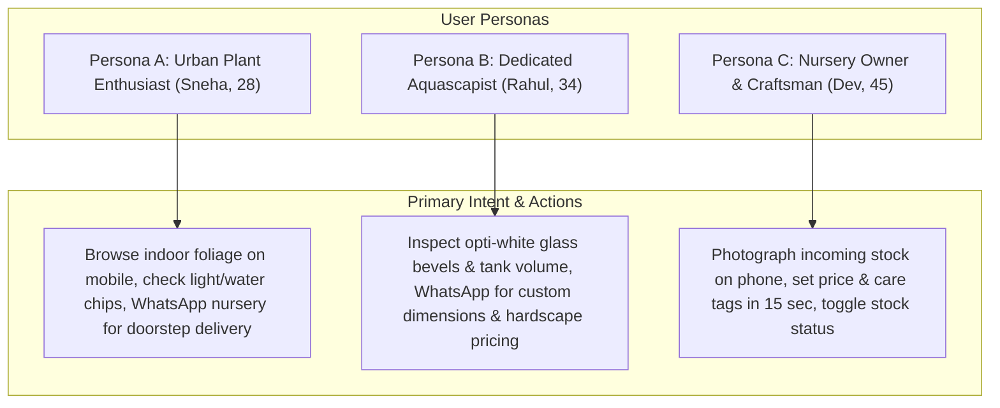

# Product Requirements Document (PRD)

**Project Name:** Nature House — Plant Nursery & Handcrafted Aquariums  
**Document Version:** 1.0  
**Status:** Approved  
**Scale & Load Target:** 100–200 concurrent active visitors on the page (Lean & High-Performance Architecture)  
**Cost Target:** ₹0 / $0 monthly operational cost (100% Lifetime Free Tier)  

---

## 1. Product Vision & Executive Overview

### 1.1 Vision Statement
Nature House is a premier botanical nursery and artisanal aquarium studio. The digital platform serves as a biophilic, living catalog that bridges the digital browsing experience with in-person foot traffic and direct WhatsApp consultations. 

Rather than burdening customers with a cumbersome, high-friction shopping cart, account sign-ups, and payment gateway fees, Nature House uses a **zero-friction "Browse & WhatsApp" conversion loop**. Customers discover curated indoor plants, rare exotic specimens, and custom opti-white rimless aquarium tanks online, and convert directly via one-tap WhatsApp messages or store visits.

### 1.2 Target Scale & Operating Realities
- **Concurrent Audience:** Max 100–200 active users browsing the page simultaneously.
- **Inventory Size:** 150–250 active items (split between nursery plants, planted aquascapes, and rimless glass tanks).
- **Update Frequency:** 2–5 inventory updates daily by nursery staff using smartphone cameras.
- **Infrastructure Footprint:** Zero server maintenance, zero database hosting fees, zero DevOps overhead.

---

## 2. Target Personas & User Journeys



### 2.1 Persona Details

#### Persona A: Urban Homeowner / Plant Parent (Sneha, 28)
- **Context:** Looking for air-purifying indoor plants for her apartment balcony and living room. Browses on an iPhone via Instagram bio link.
- **Pain Points:** Traditional e-commerce sites show generic stock photos; plants delivered rarely match the pictures. Confusing care guides.
- **Goal:** See real photos taken right in the nursery, know the pot size and water/light requirements at a glance, and ask on WhatsApp: *"Is this exact Monstera available for pickup today?"*

#### Persona B: Aquascaping Hobbyist / Interior Designer (Rahul, 34)
- **Context:** Wants a rimless opti-white glass tank for a centerpiece freshwater planted setup. Browses on mobile and desktop.
- **Pain Points:** Mass-market pet stores sell green-tinted float glass tanks with sloppy silicone seams. Custom aquarium builders lack transparent catalogs.
- **Goal:** Inspect crystal-clear machine-beveled joints via full-screen zoom, verify volume and glass thickness (e.g., 10mm low-iron), and tap WhatsApp to discuss cabinet pairing and custom dimensions.

#### Persona C: Nature House Owner / Staff (Dev, 45)
- **Context:** Busy in the nursery watering plants or building tanks with silicone. Uses a mid-tier Android phone with dirt or water on hands.
- **Pain Points:** Complex admin dashboards (WordPress, Shopify) take 10 minutes per item, require desktop computers, and become sluggish.
- **Goal:** Stand in front of a newly potted plant or fresh tank setup, snap a photo, tap 3 preset chips, type price, hit publish, and have it live in 15 seconds.

---

## 3. Product Scope & Functional Requirements

### 3.1 Public Digital Catalog (`/`)

| Feature ID | Feature Name | Description | Priority |
| :--- | :--- | :--- | :--- |
| **PUB-01** | Biophilic Brand Header | Displays Nature House branding, operating hours, real-time "Open Now / Closed" indicator, direct phone link, and nursery address link. | P0 |
| **PUB-02** | Sliding Section Switcher | Single-page fluid switch between **🌿 Nursery Plants** and **🐟 Handcrafted Aquariums** with spring animations. No page reloads. | P0 |
| **PUB-03** | Category Filter Pills | Quick horizontal scrolling filter pills (e.g., *Indoor*, *Flowering*, *Rare Foliage*, *Rimless Tanks*, *Planted Sets*, *Hardscape*). | P0 |
| **PUB-04** | Plant Model Card | High-res photo, item title, botanical subtitle, 4 visual care chips (Light, Water, Pot Size, Difficulty), price in INR (₹), stock badge, and WhatsApp CTA. | P0 |
| **PUB-05** | Aquarium Model Card | High-res photo, tank title, glass specifications (Low-Iron Opti-White, thickness in mm), volume in liters, dimensions, price, and WhatsApp CTA. | P0 |
| **PUB-06** | Photo Lightbox Inspection | Tapping any card photo opens a responsive full-screen lightbox with backdrop blur for edge-to-edge leaf and silicone joint inspection. | P1 |
| **PUB-07** | Pre-Filled WhatsApp Protocol | WhatsApp button triggers `wa.me` deep link with pre-formatted inquiry text containing item name, SKU/ID, price, and inquiry query. | P0 |
| **PUB-08** | Nursery Location & Navigation | Physical nursery address, opening hours, parking info, and one-tap Google Maps directions link. | P0 |

### 3.2 Private Owner Portal (`/admin`)

| Feature ID | Feature Name | Description | Priority |
| :--- | :--- | :--- | :--- |
| **ADM-01** | Secure PIN/Password Auth | Lightweight, secure session authentication without public sign-up routes. Direct login for store owner. | P0 |
| **ADM-02** | Mobile Direct Camera Upload | Tap camera icon to trigger native smartphone camera or photo gallery selection. | P0 |
| **ADM-03** | Client-Side WebP Compression | Web Worker compresses raw 5MB–12MB smartphone photos to ~150KB WebP before upload, saving bandwidth and storage. | P0 |
| **ADM-04** | Quick Form Spec Chips | Pre-configured selectable chips for lighting (Bright Indirect, Low Light), watering (Daily, Weekly), and glass types (Opti-White, 8mm, 10mm). | P1 |
| **ADM-05** | Real-Time Stock Status Toggle | Instant 1-tap toggle (`In Stock` ⇄ `Sold Out`) without having to delete and re-create cards. | P0 |
| **ADM-06** | Cascade Delete & Storage Purge | Permanently deletes card record from PostgreSQL AND purges all associated `.webp` files from Supabase Storage bucket. | P0 |
| **ADM-07** | Real-Time Catalog Revalidation | Triggers Next.js On-Demand ISR revalidation upon card mutation so changes appear immediately to visitors. | P0 |

---

## 4. User Experience & Interaction Specifications

### 4.1 Conversion Flow (Browse ➔ WhatsApp)
```
[Visitor Browsing] 
       │
       ▼
[Taps "💬 Inquire on WhatsApp" on "3ft Rimless Aquascape Tank"]
       │
       ▼
[System Generates Encoded URL]
https://wa.me/91XXXXXXXXXX?text=Hi%20Nature%20House,%20I%20am%20interested%20in%20the%20*3ft%20Rimless%20Aquascape%20Tank*%20(₹8,500).%20Is%20this%20currently%20available%20for%20pickup/customization?
       │
       ▼
[WhatsApp Mobile App / Web Launches Immediately]
       │
       ▼
[Personal, Direct Interaction with Nursery Owner — Zero Checkout Abandonment]
```

### 4.2 Lightbox Zoom Mechanics
- **Trigger:** Single tap or click on any catalog card image.
- **Backdrop:** 90% opacity deep slate with `backdrop-filter: blur(12px)`.
- **Gesture:** Pinch-to-zoom on iOS/Android; double-click or scroll-wheel to zoom on desktop.
- **Dismissal:** Tap close button `✕`, tap anywhere on backdrop, or press `Escape`.

---

## 5. Non-Functional Requirements (Tailored for 100–200 Users)

### 5.1 Performance & Latency
- **First Contentful Paint (FCP):** < 0.8 seconds on 4G mobile connections.
- **Largest Contentful Paint (LCP):** < 1.4 seconds (optimized WebP images served from Vercel/Supabase edge CDNs).
- **Cumulative Layout Shift (CLS):** 0.00 (fixed aspect ratios for all photo containers `aspect-[4/3]`).
- **Core Web Vitals:** 95+ score on Google Lighthouse mobile & desktop.

### 5.2 Capacity & Resource Utilization
- **Concurrent Visitors:** 100–200 concurrent sessions seamlessly handled by serverless edge cache (Next.js static pre-rendering).
- **Bandwidth Consumption:** ~1.2 MB per initial visitor session (HTML + CSS + JS + 6–8 initial compressed card images). 
- **Monthly Traffic Projection:** 15,000–30,000 monthly visits consumes ~25–35 GB of Vercel's 100 GB free tier.
- **Database Load:** Near zero compute utilization because public catalog reads are served via edge ISR cache, invalidating only when the owner creates or edits cards.

### 5.3 Reliability & Availability
- **Uptime SLA:** 99.9% uptime backed by Vercel Edge Network and Supabase Managed PostgreSQL.
- **Disaster Recovery:** Automated weekly SQL schema & data dumps; zero state stored on the Vercel server layer.

---

## 6. Out-of-Scope (Preserving $0 Cost & Simplicity)

To guarantee the system remains 100% free forever and requires zero ongoing maintenance for the nursery owner, the following features are deliberately **excluded**:

1. **Integrated Payment Gateways (Razorpay / Stripe):**
   - *Rationale:* Adds transaction fees (2–3%), requires PCI compliance, complicates inventory reconciliation for live biological specimens, and introduces cart abandonment. WhatsApp direct orders are superior for living plants and custom tanks.
2. **Customer User Accounts & Passwords:**
   - *Rationale:* Customers should never need to register or log in to view plants or inquire. Eliminates authentication overhead and personal data liability.
3. **Automated Shipping & Courier APIs:**
   - *Rationale:* Live tropical plants and fragile glass aquariums cannot be shipped via standard parcel couriers (e.g., BlueDart/Delhivery) without specialized packing. Nursery arranges local pickup or dedicated vehicle delivery via WhatsApp.
4. **Third-Party Heavy Analytics / Tracking Scripts:**
   - *Rationale:* Bloats page weight, slows load times, and creates privacy compliance burdens. Minimal, privacy-friendly telemetry or Vercel Web Analytics is used instead.
