# Security, Privacy & DPDP Compliance Guide

**Project Name:** Nature House (Digital Catalog & Admin Portal)  
**Document Version:** v1.0 (Finalized for Production Deployment)  
**Date:** October 19, 2026  
**Status:** Approved & Finalized for Deployment  
**Compliance Standard:** Digital Personal Data Protection (DPDP) Act 2023 & Information Technology Act 2000  
**Security Posture:** Zero-PII Public Experience & Defense-in-Depth Admin Controls  

---

## 1. Architectural Privacy Philosophy: "Privacy-by-Design"

For a boutique nursery and handcrafted aquarium studio, the most secure data strategy is **not collecting customer data in the first place**.

```mermaid
flowchart TD
    subgraph Traditional_Ecommerce ["Traditional E-Commerce (High Liability)"]
        T1["User Registration"] --> T2["Stores Name, Email, Password"]
        T2 --> T3["Checkout Form: Stores Address, Phone, Cards"]
        T3 --> T4["Tracking Pixels (FB, Google Ads, Cookies)"]
        T4 --> T5["Heavy DPDP Data Fiduciary Burden & Audit Risk"]
    end

    subgraph Nature_House_Model ["Nature House Model (Zero Liability)"]
        N1["Browse Catalog Anonymously"] --> N2["Zero PII Stored in Database"]
        N2 --> N3["No Tracking Cookies / No Ad Pixels"]
        N3 --> N4["Direct WhatsApp Click-to-Chat (End-to-End Encrypted)"]
        N4 --> N5["Full DPDP Compliance by Default"]
    end
```

---

## 2. DPDP Act 2023 Compliance Matrix

The Digital Personal Data Protection Act (DPDP) 2023 establishes obligations for Data Fiduciaries. Nature House operates under a lean, fully compliant framework:

| DPDP Section | Legal Requirement | Nature House Implementation | Compliance Status |
| :--- | :--- | :--- | :--- |
| **Section 4 & 5** | Lawful Purpose & Clear Notice | Nature House does not collect personal data from visitors browsing the catalog. A lightweight Privacy Notice informs users that WhatsApp interactions are direct and voluntary. | 🟢 100% Compliant |
| **Section 6** | Free & Specific Consent | When a visitor taps "Inquire on WhatsApp", they explicitly initiate the conversation from their own WhatsApp client. No forced consent banners required. | 🟢 100% Compliant |
| **Section 7** | Legitimate Uses | Contact details shared during WhatsApp chats (for delivery coordinates) are used solely to fulfill the plant or aquarium purchase and never shared with brokers. | 🟢 100% Compliant |
| **Section 8(5)** | Reasonable Security Safeguards | Admin portal enforces cryptographic authentication, scrypt password hashing, session versioning, and HTTPS transport. | 🟢 100% Compliant |
| **Section 9** | Processing of Children's Data | No behavioral tracking, profiling, or targeted advertising is conducted on visitors of any age. | 🟢 100% Compliant |
| **Section 12** | Right to Grievance Redressal | Nursery owner's official contact and address are displayed transparently in the site footer for any inquiries or grievances. | 🟢 100% Compliant |

---

## 3. Administrative Security & Threat Mitigations

Following the comprehensive security audit (`design_docket/CODEBASE_AUDIT.md`), the following enterprise-grade defense-in-depth measures have been deployed:

### 3.1 Elimination of Public Password Reset (NH-SEC-01)
- **Vulnerability Remediated:** The previous `/api/admin/reset-password` endpoint returned signed reset tokens and verification codes directly in JSON.
- **Remediation:** The public HTTP reset endpoint is permanently decommissioned (returns `410 Gone`). All administrative credential updates are performed exclusively via local, interactive CLI scripts on the server:
  - `node scripts/admin-create.mjs`
  - `node scripts/admin-reset.mjs`

### 3.2 Hardened Cryptographic Password Storage (NH-SEC-02)
- **Hashing Engine:** Node.js native `crypto.scrypt` with unique 16-byte random salts.
- **Scrypt Parameters:** $N=16384$, $r=8$, $p=1$, output length 64 bytes.
- **Comparison:** Constant-time buffer comparison via `crypto.timingSafeEqual` prevents timing side-channel attacks.

### 3.3 Database-Backed Session Versioning & Invalidation (NH-SEC-03)
- Admin accounts are authoritatively stored in PostgreSQL (`admin_accounts`).
- Each account tracks a `token_version` integer.
- Changing an admin password via CLI increments `token_version`.
- Every incoming request to `verifyAdminSession()` validates the JWT's `tokenVersion` against the database; older sessions are revoked instantaneously.

### 3.4 Cookie Lifecycle & Transport Security (NH-AUTH-04)
- Session cookies (`nature_house_admin_session`) are issued with:
  - `HttpOnly: true` (inaccessible to JavaScript)
  - `SameSite: 'lax'` (CSRF protection)
  - `Secure: true` in production
  - `Path: '/'`
  - `maxAge: 7 * 24 * 3600` (strictly bounded 7-day lifespan)
- Logout is strictly restricted to `POST /api/admin/logout`.

### 3.5 Brute-Force & Rate Limiting Protection
- Failed login attempts are throttled per IP and email.
- Exceeding 5 failed attempts triggers a 15-minute lockout.
- Authentication responses return generic error messages ("Invalid administrator credentials") to prevent user enumeration.

### 3.6 Media Upload Validation & Safe Streaming (NH-PERF-01, NH-DATA-03)
- Uploads are accepted only by authenticated admins via `POST /api/admin/media`.
- File content is verified via MIME magic bytes (JPEG, PNG, WebP). File extension spoofing is rejected.
- Uploads are assigned random UUID keys and written atomically to `var/media/`.
- Safe streaming route `GET /media/[mediaId]` strictly validates UUID format against path traversal (`../`) and enforces `X-Content-Type-Options: nosniff`.
- Deleting an inventory item schedules the media key for cleanup in `media_cleanup_queue`.

### 3.7 API Request Validation & Error Shielding (NH-API-01, NH-API-02)
- All incoming mutation payloads are parsed and validated using schemas in `src/lib/validations.ts`.
- Server internal details and database stack traces are sanitized via `handleApiError()`. Production responses return structured JSON with safe error messages and correlation IDs.
