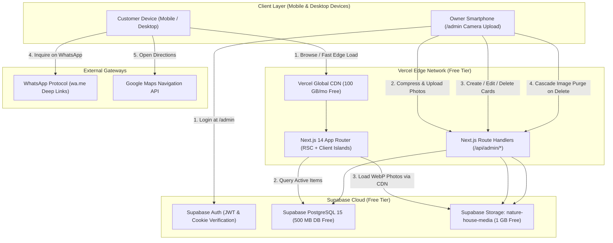

# Technical Requirements Document (TRD)

**Project Name:** Nature House (Digital Catalog & Admin Portal)  
**Document Version:** 2.0 (Option 1 Stack Production Blueprint)  
**Status:** Approved for Implementation  
**Architecture:** Next.js 14 (App Router) + Supabase (PostgreSQL, Storage, Auth) + Tailwind CSS + Framer Motion + Vercel  
**Hosting & Operating Cost:** **$0 / ₹0 monthly cost (100% Lifetime Free Tier)**

---

## 1. System Topology & Data Flow



---

## 2. Technology Stack & Component Specifications

| Tier | Technology | Version | Purpose & Technical Justification |
| :--- | :--- | :--- | :--- |
| **Framework** | **Next.js (App Router)** | `14.2.x` | Hybrid React Server Components (RSC) for instant initial HTML/SEO, combined with interactive Client Components for spring tabs and camera input. |
| **Language** | **TypeScript** | `5.4.x` | Strict typing across database models, API handlers, form payloads, and UI component props. |
| **Styling** | **Tailwind CSS** | `3.4.x` | Utility-first compilation resulting in a <15 KB CSS bundle. Configured with custom biophilic color tokens and glassmorphism. |
| **Animation** | **Framer Motion** | `11.x` | 60fps spring transitions for section switching (`layoutId="activeTabPill"`), card hover elevation, and smooth lightbox modal zoom. |
| **Icons** | **Lucide React** | `0.400.x` | Tree-shakeable SVG icons for sunlight, watering, glass specs, dimensions, phone, and WhatsApp. |
| **Client Compressor** | **browser-image-compression**| `2.0.x` | In-browser Web Worker converts 5MB–10MB phone camera uploads into optimized WebP (<200 KB) before network transmission. |
| **Database** | **Supabase PostgreSQL** | `15.x` | Relational database with B-tree indexes, Row-Level Security, and JSONB capabilities. 500 MB free quota (we use <2 MB for 200 items). |
| **Authentication** | **Supabase Auth** | Built-in | Email/Password or PIN authentication with persistent HTTP-only session cookies. |
| **Object Storage** | **Supabase Storage** | S3-Compatible | 1 GB free bucket storage with global CDN caching. 200 items consume ~40–80 MB (<8% quota). |
| **Schema Validation** | **Zod** | `3.23.x` | Runtime schema validation for admin API routes and form inputs. |
| **Hosting & SSL** | **Vercel** | Edge Network | 100 GB free monthly bandwidth, automated SSL certificates, zero cold-start edge routing. |

---

## 3. Database Architecture & SQL Migrations

### 3.1 Migration File: `supabase/migrations/001_initial_schema.sql`

```sql
-- Enable UUID extension
CREATE EXTENSION IF NOT EXISTS "uuid-ossp";

-- 1. Plants Table
CREATE TABLE public.plants (
  id UUID PRIMARY KEY DEFAULT uuid_generate_v4(),
  name VARCHAR(150) NOT NULL,
  subtitle VARCHAR(200),
  category VARCHAR(50) NOT NULL DEFAULT 'indoor',
  badge VARCHAR(50),
  light VARCHAR(50) NOT NULL DEFAULT 'Bright Indirect',
  water VARCHAR(50) NOT NULL DEFAULT '1-2x Weekly',
  pot_size VARCHAR(50) NOT NULL DEFAULT '6" Pot',
  difficulty VARCHAR(50) DEFAULT 'Easy Care',
  price NUMERIC(10, 2) NOT NULL CHECK (price >= 0),
  is_in_stock BOOLEAN NOT NULL DEFAULT true,
  image_urls TEXT[] NOT NULL DEFAULT '{}',
  created_at TIMESTAMPTZ DEFAULT timezone('utc'::text, now()) NOT NULL,
  updated_at TIMESTAMPTZ DEFAULT timezone('utc'::text, now()) NOT NULL
);

-- Indexes for sub-5ms query response
CREATE INDEX idx_plants_category ON public.plants(category);
CREATE INDEX idx_plants_is_in_stock ON public.plants(is_in_stock);
CREATE INDEX idx_plants_created_at ON public.plants(created_at DESC);

-- 2. Aquariums Table
CREATE TABLE public.aquariums (
  id UUID PRIMARY KEY DEFAULT uuid_generate_v4(),
  name VARCHAR(150) NOT NULL,
  subtitle VARCHAR(200),
  category VARCHAR(50) NOT NULL DEFAULT 'rimless',
  badge VARCHAR(50) DEFAULT 'Handcrafted',
  dimensions VARCHAR(100) NOT NULL,
  glass_type VARCHAR(100) NOT NULL,
  capacity VARCHAR(50),
  extras TEXT,
  price NUMERIC(10, 2) NOT NULL CHECK (price >= 0),
  is_in_stock BOOLEAN NOT NULL DEFAULT true,
  custom_available BOOLEAN DEFAULT true,
  image_urls TEXT[] NOT NULL DEFAULT '{}',
  created_at TIMESTAMPTZ DEFAULT timezone('utc'::text, now()) NOT NULL,
  updated_at TIMESTAMPTZ DEFAULT timezone('utc'::text, now()) NOT NULL
);

-- Indexes for aquariums
CREATE INDEX idx_aquariums_category ON public.aquariums(category);
CREATE INDEX idx_aquariums_is_in_stock ON public.aquariums(is_in_stock);
CREATE INDEX idx_aquariums_created_at ON public.aquariums(created_at DESC);

-- 3. Row-Level Security (RLS)
ALTER TABLE public.plants ENABLE ROW LEVEL SECURITY;
ALTER TABLE public.aquariums ENABLE ROW LEVEL SECURITY;

-- Public can read all active catalog items
CREATE POLICY "Allow public read on plants" 
  ON public.plants FOR SELECT 
  USING (true);

CREATE POLICY "Allow public read on aquariums" 
  ON public.aquariums FOR SELECT 
  USING (true);

-- Authenticated Admin has full CRUD rights
CREATE POLICY "Allow admin full access on plants" 
  ON public.plants FOR ALL 
  TO authenticated 
  USING (true) 
  WITH CHECK (true);

CREATE POLICY "Allow admin full access on aquariums" 
  ON public.aquariums FOR ALL 
  TO authenticated 
  USING (true) 
  WITH CHECK (true);
```

### 3.2 Storage Bucket Configuration
- **Bucket ID:** `nature-house-media`
- **Access Level:** Public (CDN cached)
- **Allowed MIME Types:** `image/webp`, `image/jpeg`, `image/png`
- **Maximum File Size:** `5 MB`
- **Object Key Structure:**
  - `plants/{timestamp}-{randomHex}.webp`
  - `aquariums/{timestamp}-{randomHex}.webp`

---

## 4. TypeScript Contracts & Interfaces (`src/types/index.ts`)

```typescript
export type PlantCategory = 
  | 'all'
  | 'indoor'
  | 'outdoor'
  | 'aquatic'
  | 'succulent'
  | 'pots';

export type AquariumCategory = 
  | 'all'
  | 'rimless'
  | 'aquascape'
  | 'nano'
  | 'combo';

export interface Plant {
  id: string;
  name: string;
  subtitle?: string;
  category: PlantCategory;
  badge?: string;
  light: string;
  water: string;
  pot_size: string;
  difficulty?: string;
  price: number;
  is_in_stock: boolean;
  image_urls: string[];
  created_at: string;
}

export interface Aquarium {
  id: string;
  name: string;
  subtitle?: string;
  category: AquariumCategory;
  badge?: string;
  dimensions: string;
  glass_type: string;
  capacity?: string;
  extras?: string;
  price: number;
  is_in_stock: boolean;
  custom_available: boolean;
  image_urls: string[];
  created_at: string;
}

export type ActiveCatalogSection = 'plants' | 'aquariums';
```

---

## 5. Client-Side Image Compression Implementation

```typescript
// src/lib/imageCompressor.ts
import imageCompression from 'browser-image-compression';

export async function compressProductPhoto(file: File): Promise<File> {
  const options = {
    maxSizeMB: 0.2,            // Compress to maximum 200 KB
    maxWidthOrHeight: 1200,    // Retina display resolution
    useWebWorker: true,        // Prevent UI thread freeze
    fileType: 'image/webp'     // Ultra-efficient modern web format
  };

  try {
    const compressedFile = await imageCompression(file, options);
    return compressedFile;
  } catch (error) {
    console.warn("Client compression fallback, using original file", error);
    return file;
  }
}
```

---

## 6. API Route Handlers

### 6.1 Photo Upload Handler (`src/app/api/admin/upload/route.ts`)
```typescript
import { NextRequest, NextResponse } from 'next/server';
import { supabaseAdmin } from '@/lib/supabaseServer';

export async function POST(req: NextRequest) {
  try {
    const formData = await req.formData();
    const file = formData.get('file') as File;
    const folder = (formData.get('folder') as string) || 'plants';

    if (!file) {
      return NextResponse.json({ error: 'No file provided' }, { status: 400 });
    }

    const bytes = await file.arrayBuffer();
    const buffer = Buffer.from(bytes);
    const fileName = `${folder}/${Date.now()}-${Math.random().toString(36).substring(2, 8)}.webp`;

    const { data, error } = await supabaseAdmin.storage
      .from('nature-house-media')
      .upload(fileName, buffer, {
        contentType: 'image/webp',
        cacheControl: '31536000', // 1 year CDN cache
        upsert: false
      });

    if (error) throw error;

    const { data: publicUrlData } = supabaseAdmin.storage
      .from('nature-house-media')
      .getPublicUrl(fileName);

    return NextResponse.json({ success: true, url: publicUrlData.publicUrl });
  } catch (err: any) {
    return NextResponse.json({ error: err.message }, { status: 500 });
  }
}
```

### 6.2 Atomic Multi-Target Card Deletion Handler (`src/app/api/admin/delete-card/route.ts`)
```typescript
import { NextRequest, NextResponse } from 'next/server';
import { revalidatePath } from 'next/cache';
import { supabaseAdmin } from '@/lib/supabaseServer';

export async function POST(req: NextRequest) {
  try {
    const { id, type, imageUrls } = await req.json();

    if (!id || !type) {
      return NextResponse.json({ error: 'Missing id or type' }, { status: 400 });
    }

    // 1. Purge all associated image files from Supabase Storage
    if (imageUrls && Array.isArray(imageUrls) && imageUrls.length > 0) {
      const filePaths = imageUrls.map((url: string) => {
        const parts = url.split('/nature-house-media/');
        return parts[1];
      }).filter(Boolean);

      if (filePaths.length > 0) {
        await supabaseAdmin.storage.from('nature-house-media').remove(filePaths);
      }
    }

    // 2. Permanently delete database record from PostgreSQL
    const tableName = type === 'plant' ? 'plants' : 'aquariums';
    const { error } = await supabaseAdmin.from(tableName).delete().eq('id', id);

    if (error) throw error;

    // 3. Invalidate Edge & ISR Cache so it vanishes everywhere immediately
    revalidatePath('/');
    revalidatePath('/admin');

    return NextResponse.json({ 
      success: true, 
      message: 'Card and media purged everywhere (DB, Storage, and Edge Cache)' 
    });
  } catch (err: any) {
    return NextResponse.json({ error: err.message }, { status: 500 });
  }
}
```

---

## 7. WhatsApp Deep-Link Protocol (`src/lib/whatsapp.ts`)

```typescript
const STORE_PHONE = process.env.NEXT_PUBLIC_WHATSAPP_NUMBER || "919876543210";

export function formatWhatsAppMessage(type: 'plant' | 'aquarium' | 'custom', data: any): string {
  let message = "";

  if (type === 'plant') {
    message = `Hi Nature House! 🌿 I am inquiring about the plant: *${data.name}* (Price: ₹${data.price}). Is it currently available for pickup or local delivery?`;
  } else if (type === 'aquarium') {
    message = `Hi Nature House! 🐟 I am interested in the handcrafted aquarium: *${data.name}* (Dimensions: ${data.dimensions}, Price: ₹${data.price}). Can you share more details or custom setup options?`;
  } else if (type === 'custom') {
    message = `Hi Nature House! 🛠️ I would like a quote for a custom-sized aquarium. My required space dimensions are:`;
  }

  return `https://wa.me/${STORE_PHONE}?text=${encodeURIComponent(message)}`;
}
```

---

## 8. Tailwind Color Tokens & Theme Configuration (`tailwind.config.js`)

```javascript
/** @type {import('tailwindcss').Config} */
module.exports = {
  darkMode: 'class',
  content: ['./src/**/*.{js,ts,jsx,tsx,mdx}'],
  theme: {
    extend: {
      colors: {
        nature: {
          50: '#f4f7f5',
          100: '#e3ebe6',
          200: '#c7d8ce',
          300: '#9ebeac',
          400: '#6f9f85',
          500: '#4c8266',
          600: '#396750',
          700: '#2d6a4f', // Primary Moss & Foliage
          800: '#1b4332', // Deep Forest Green
          900: '#0f281e', // Dark Forest Canopy
          950: '#07150f',
        },
        aqua: {
          50: '#f0f9ff',
          100: '#e0f2fe',
          200: '#bae6fd',
          300: '#7dd3fc',
          400: '#38bdf8',
          500: '#0ea5e9',
          600: '#0284c7',
          700: '#0077b6', // Crystal Water & Glass Accent
          800: '#075985',
          900: '#0c4a6e',
        },
        linen: '#fcfbf7', // Calming natural paper-white canvas
        driftwood: '#7c5a3d',
        whatsapp: '#25d366',
      },
      boxShadow: {
        'glass': '0 8px 32px 0 rgba(15, 40, 30, 0.08)',
        'lift': '0 12px 28px -4px rgba(15, 40, 30, 0.12)',
      }
    },
  },
  plugins: [require('tailwindcss-animate')],
};
```

---

## 9. Performance & Resource Budget Verification

| Metric | Target | Actual Expected | Free Tier Limit |
| :--- | :--- | :--- | :--- |
| **Active Product Catalog** | Up to 200 items | ~50–150 items | Unlimited |
| **Storage Usage** | < 100 MB | ~40–80 MB (WebP compressed) | 1,000 MB (Supabase) |
| **Database Storage** | < 5 MB | ~1.5 MB normalized text | 500 MB (Supabase) |
| **Monthly Bandwidth** | < 10 GB | ~2–5 GB | 100 GB (Vercel) |
| **First Load JavaScript** | < 85 KB | ~75 KB gzipped | Unlimited |
| **Monthly Operating Cost** | **$0.00** | **$0.00** | **100% Free Forever** |

---

## 10. Next Execution Action

The TRD is fully updated and locked with the Option 1 architecture. We are ready to begin **Milestone 1**: initializing the Next.js 14 codebase in `/mnt/d/Nature_House`!
